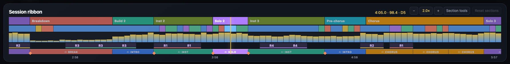

# HitMapper

HitMapper is a self-contained, local song-analysis workspace. Upload a mix in the browser and it builds a session-musician-style map of the track: beat grid, song sections, chords, energy, transition candidates, and repeated patterns.

Everything runs on your own computer in Docker; your recordings are not uploaded anywhere.


The session ribbon, zoomed in around the playhead: editable sections, chords, bar energy, repeat groups (R1–R4), the AI model's own segments and transition markers.



## Run with Docker

Start Docker Desktop or a Docker Engine with the Compose plugin. From the HitMapper folder, run:

```bash
docker compose up --build -d
```

Open <http://127.0.0.1:8766/>. On macOS, you can instead double-click `Start HitMapper Docker.command`, which starts Docker Desktop if needed.

HitMapper only accepts connections from the same computer, and only from its own page (other websites open in your browser can't use it). It has no login, so if you want to open it from another machine, only do so on a network you trust: in `compose.yaml`, change the port line from `"127.0.0.1:8766:8766"` to `"8766:8766"`, add an `environment:` entry `HITMAPPER_ALLOWED_HOSTS: "my-mac.local"` with the name or address you'll type in the browser, and run `docker compose up -d` again.

The first build downloads the analysis stack. The first analysis can also download model weights. Later launches and analyses reuse files in the `hitmapper-data` Docker volume.

Run `docker compose down` to stop the app while keeping its library. To apply source changes to a running installation, run `docker compose up --build -d` and reload the browser.

## Open or add a song

HitMapper opens at **Choose a song**. Select **Open map** beside a ready upload or use the upload area to add a recording. The **Songs** button takes you back to the library from an open map. A URL with `?song=<project-id>` opens that specific map when the song is available on the same installation.

1. Drop or select an MP3, WAV, FLAC, M4A, AAC, OGG, OPUS, or AIFF file.
2. Optionally enter a display name, then click **Analyze song**. Leave HitMapper running while it processes the track. The completed map opens automatically while the browser is tracking the job.
3. If analysis fails, use **Retry** beside the failed song in the library. Retry uses the saved recording and can reuse completed analysis work.

Recordings must be between one second and 30 minutes long. The structure model's memory use grows with the song's length: Docker Desktop's default of about 8 GB is enough for songs of a few minutes; a 7-minute song peaked at about 8.7 GB. For longer songs, raise Docker's memory (Docker Desktop › Settings › Resources › Memory; 16 GB or more) before analysing. If an analysis runs out of memory, HitMapper says so; raise the memory and press **Retry**. The default upload request limit is 500 MiB. Audio is analyzed on the machine running Docker. Internet access is used to download dependencies and model weights when needed.

## Session controls

- Space: play or pause
- Left / right arrow: move five seconds
- Shift + left / right arrow: previous or next musical event
- L: loop the current section
- Click the wheel or session ribbon to seek
- Use **Hear AI markers** to listen for detected beats and model boundaries
- Zoom the ribbon horizontally, drag a section divider to a bar, or use **Section tools** at the playhead to rename a section or add or remove dividers
- “Add timestamp” inserts the current time, bar/beat, and chord into the locally saved session notes

Use the chart as a starting point for listening. The main section lane and wheel show the same arrangement, including any manual edits. The AI lane shows the underlying model segments.

## What the analysis does

- Detects tempo, beats, downbeats, and labeled segments with the `harmonix-all` ensemble. HitMapper turns them into this song's own sections, named with standard types: it keeps the model's verse, chorus, bridge, solo and outro, and names other passages from what the audio does there (Intro, Build, Pre-chorus, Breakdown, Interlude, Instrumental). You can rename and move any section.
- Separates bass, drums, vocals, and other material. The chord chart combines neural chroma with tuned pitch-class features from the mix and stems, bass evidence, and tonal context.
- Estimates bar energy, flags transition candidates based on changes in the sound, and groups similar two-to-four-bar passages as repeat candidates.
- Creates marker audio for checking detected beats and model boundaries by ear.

## Data and troubleshooting

Compose mounts its named volume `hitmapper-data` at `/data` in the container. Each song has a directory at `/data/projects/<project-id>/` with the original upload, `project.json`, the finished `analysis.json`, `analysis.log`, and intermediate files under `work/`. The app analyzes one song at a time. Notes, ribbon zoom, and manual section edits live in the browser’s local storage for the app’s origin. Keep the Docker volume and browser data when moving an existing session.

For startup failures or a stuck upload, run these from the HitMapper folder:

```bash
docker compose ps
curl -fsS http://127.0.0.1:8766/api/status
docker compose logs --tail=100 hitmapper
```

For an analysis failure, get the failed song’s `id` from `/api/status`. Replace `PROJECT_ID` in the command below with that ID to see the latest analyzer output:

```bash
docker compose exec hitmapper tail -n 80 /data/projects/PROJECT_ID/analysis.log
```

## Development without Docker

Docker is the reference environment. For a native development setup, use Python 3.11, Git, `ffmpeg` and `ffprobe`, and the packages in `requirements.txt`. Native dependencies may require a C compiler and FFTW or libsndfile development libraries. See `Dockerfile` for the working Linux package and CPU PyTorch setup. The native server also listens on this computer only; set `HITMAPPER_HOST=0.0.0.0` to change that.

```bash
python3.11 -m venv .runtime-data/venv
source .runtime-data/venv/bin/activate
python -m pip install -r requirements.txt
HITMAPPER_DATA_DIR=.runtime-data python server.py
```

Open <http://127.0.0.1:8766/>. The native server has its own song library under `.runtime-data/` with this command.

The automated tests need only Flask and ffmpeg, not the audio models:

```bash
python3 -m venv .venv && .venv/bin/pip install -r requirements-test.txt
.venv/bin/python -m unittest discover -s tests
```

See [docs/DEVELOPMENT.md](docs/DEVELOPMENT.md) for the code map, API, data contract, and verification checklist, and [CHANGELOG.md](CHANGELOG.md) for what changed.

## Credits and licences

HitMapper is MIT licensed; see [LICENSE](LICENSE). It builds on [All-In-One-Infer](https://github.com/openmirlab/all-in-one-infer) (MIT), based on [All-In-One](https://github.com/mir-aidj/all-in-one), and on [madmom](https://github.com/CPJKU/madmom) through the [madmom-modern](https://github.com/imcmurray/madmom-modern) fork, as well as librosa, PyTorch, Demucs and FFmpeg. These are downloaded when the Docker image is built or on the first analysis. Their model files carry their own licences: madmom's are CC BY-NC-SA 4.0, which does not allow commercial use. Check each project's licence before using HitMapper commercially.
